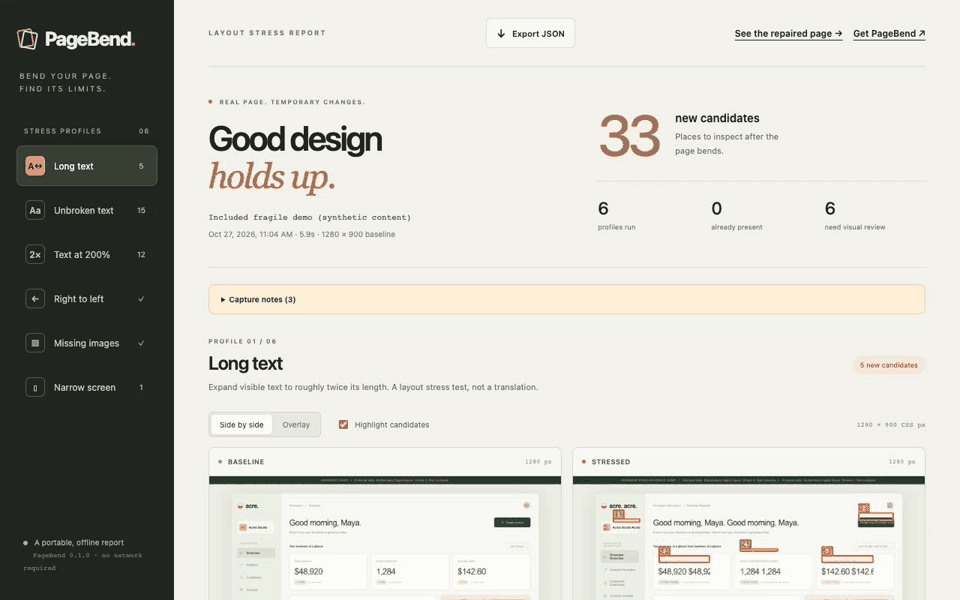

# PageBend

**页面在示例数据下很好看，遇到真实内容呢？**

一条命令，给真实网页施加长文本、大字体、窄屏、从右向左排版和图片缺失等压力，生成可以离线打开的前后对照报告。不需要 API Key，不需要先写测试脚本。

[打开真实演示报告](https://easonsong666666-design.github.io/pagebend/) · [English](README.md) · [下载版本](https://github.com/easonsong666666-design/pagebend/releases)



[观看体积更小的视频](https://easonsong666666-design.github.io/pagebend/demo.webm) · [查看静态截图](docs/preview.png)

正常的名字能放进卡片，长一点的客户姓名却被截断；英文按钮没问题，文字变长后就溢出；用户放大字体，固定高度的容器就装不下。这些问题不一定能从一张漂亮的正常截图中发现。

PageBend 用 Chromium 打开你的页面，每个场景从独立的浏览器环境开始，只在浏览器中临时改变内容。它保留原始和受压截图，测量布局变化，区分原本存在的问题和新增候选，并提供元素选择器、像素测量与可复制的修复提示。

想看完整修复过程，可以阅读[一个按钮如何被裁切、修改 CSS 后怎样复查](docs/repair-walkthrough.md)（英文）。

## 开始使用

需要 **Node.js 20 或以上**。用一条命令试跑内置页面，无需全局安装，也不需要 Git：

```sh
npx --yes https://github.com/easonsong666666-design/pagebend/releases/download/v0.1.2/pagebend-0.1.2.tgz demo --setup --open
```

`--setup` 会在需要时安装匹配的 Chromium，然后生成报告并打开；首次下载可能需要几分钟。已有 Chrome 时，把 `--setup` 换成 `--channel chrome` 即可跳过下载。扫描在本机运行，不需要账户或 API key，没有遥测，也不上传页面。

通过 `npx` 试跑时，Playwright 可能提示尚未安装项目依赖。PageBend 已包含所需依赖，这个演示无需另行执行 `npm install`，可以让安装继续。安装成功后会显示 `Chromium is ready. Starting the scan.`，扫描结束后显示报告路径；如果安装确实失败，命令会停止并显示 `Chromium setup failed`。

把 `demo` 换成 `http://localhost:3000` 就能检查自己的应用，加上 `--out my-app-report` 可以与演示报告分开保存。当前版本从 GitHub 发布包安装，尚未发布到 npm registry。

经常使用时，可以安装一次：

```sh
npm install -g https://github.com/easonsong666666-design/pagebend/releases/download/v0.1.2/pagebend-0.1.2.tgz
pagebend http://localhost:3000 --setup --out my-app-report --open
```

浏览器装好后可以省略 `--setup`。也可以继续用 `pagebend install-browser` 单独安装浏览器，适合 CI 等需要分步执行的环境。

也可以克隆仓库：

```sh
git clone https://github.com/easonsong666666-design/pagebend.git
cd pagebend
npm ci --ignore-scripts
npm run install:browser
npm run demo
```

打开生成的 `pagebend-report/report.html`。截图、脚本和样式都在这一个文件中，不需要另起服务器；同目录的 `report.json` 可供 CI 或其他工具读取。再次写入同一个非空目录需要显式使用 `--force`。

## 适合哪些检查

| 场景 | 变化 |
| --- | --- |
| `long-text` | 可见文本扩展到约两倍长度 |
| `unbroken` | 加入一个 56 字符的连续长单词 |
| `text-zoom` | 计算后的字体大小翻倍，容器尺寸保持原样 |
| `narrow` | 视口缩到 375 CSS 像素 |
| `rtl` | 布局方向变成从右向左，需要人工查看 |
| `missing-images` | 将图片来源替换为无效的本地数据 URI，观察后备显示 |

```sh
pagebend http://localhost:3000 --profiles long-text,text-zoom,narrow
pagebend http://localhost:3000 --wait-for '#app-ready' --ignore '.carousel'
pagebend http://localhost:3000 --scope '#checkout' --fail-on new
pagebend demo --fixed --out pagebend-fixed-report --open
```

最后一条命令运行修复过的演示页面，使用的依然是同一个检测引擎。`pagebend --help` 提供全部参数，包括认证状态文件、浏览器选择、视口与等待时间。

## 在项目代码中使用

需要在**导入 PageBend 的项目目录内**安装依赖。全局安装或临时 `npx` 运行只提供命令行入口，不能直接让项目中的 `import 'pagebend'` 生效。

```sh
npm install --save-dev https://github.com/easonsong666666-design/pagebend/releases/download/v0.1.2/pagebend-0.1.2.tgz
npx --no-install pagebend install-browser
```

将下面的代码保存为项目内的 `check-layout.mjs`。启动自己的应用后，执行 `node check-layout.mjs`：

```js
import { scan, renderReport } from 'pagebend';
import { writeFile } from 'node:fs/promises';

const report = await scan({
  url: 'http://localhost:3000',
  profiles: ['long-text', 'narrow'],
  ignore: ['.carousel'],
});
await writeFile('report.html', renderReport(report));
```

若要加入 GitHub Actions，参见[现有工作流接入示例](docs/ci-example.md)。应用需要先启动并就绪；扫描后即使发现候选问题，也应保留报告供复查。

## 报告如何理解

检测结果是需要检查的**布局候选问题**。页面比视口宽多少像素可以测量，但一个裁切是否出于设计意图仍然需要判断。工具会排除常见的主动滚动、文字省略号和行数限制，不给出没有依据的“质量分”。

“新增”按同一场景中基线与受压后的检查类型、元素选择器比较。原有问题也可能加重，前后数值与截图会保留；同一个问题在不同场景中出现，会分别计数。默认不因候选问题返回失败；`--fail-on new` 和 `--fail-on any` 可供 CI 使用。候选导致的失败退出码为 1，执行错误为 2。

它不会修改源码、自动点击按钮或提交表单，也不代替业务流程测试、真正的翻译测试或无障碍合规审核。当前检查可见的普通 DOM；iframe、shadow DOM、canvas、CSS 背景图片和动态重新渲染等有明确覆盖限制。达到元素、候选数量或截图高度上限会在报告中说明。

报告包含页面截图和可见内容，即使网址查询参数已隐藏，页面本身仍可能包含私人信息。分享前请检查。认证状态文件只在本地读取，不会被写入报告。

欢迎提交最小可复现页面，尤其是漏报或误报案例。贡献方法见 [CONTRIBUTING.md](CONTRIBUTING.md)。MIT 许可。项目使用 AI 辅助开发，验收测试和实际能力边界均公开。
