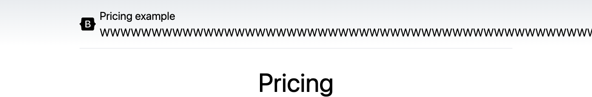
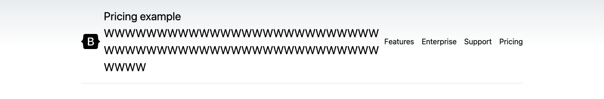

# A scoped stress experiment on a Bootstrap template

This experiment uses Bootstrap's existing pricing example, with its original CSS, to show how to stress one label and assess a possible layout change. The input is artificial: PageBend appends 56 `W` characters to the static “Pricing example” title. This is a maintainer-run experiment, **not a normal-content Bootstrap bug report, an upstream-endorsed fix, or evidence of customer adoption**.

It can inform a specific design decision: if you adapt a template to display arbitrary tenant or site names, what should happen when a name cannot break naturally? First decide whether that input is valid for your product. A static, controlled title may not need this treatment.

## What was held constant

- Bootstrap **v5.3.8**, commit [`25aa8cc0b32f0d1a54be575347e6d84b70b1acd7`](https://github.com/twbs/bootstrap/commit/25aa8cc0b32f0d1a54be575347e6d84b70b1acd7).
- The upstream [pricing template](https://github.com/twbs/bootstrap/blob/25aa8cc0b32f0d1a54be575347e6d84b70b1acd7/site/src/assets/examples/pricing/index.astro), pricing CSS, compiled Bootstrap CSS and logo, with SHA-256 checks in the reproduction script.
- PageBend **0.1.2**, its existing `unbroken` profile, a 1280 × 900 CSS-pixel viewport, and the same single-element scope: `header > div:first-child > a > span`.

The local static adaptation removes Astro frontmatter, resolves the logo to a downloaded local asset, fixes the footer year to 2025, and supplies a normal HTML document wrapper. It does not rebuild the complete Bootstrap documentation site or include its theme-picker wrapper. The original and adjusted copies use identical markup and upstream styles; only the adjusted copy loads the three additional CSS rules below. The layout was not weakened beforehand to create a finding.

## Observed result

| Measurement | Original template | With wrapping adjustment |
| --- | --- | --- |
| New candidates in the scoped title | 1 | 0 |
| Title's reported excess beyond the viewport | 196.1px | No candidate |
| Navigation links fully inside the viewport, independently inspected | 0 of 4 | 4 of 4 |
| Header row height under stress | 89px | 161px |
| Header row height before stress | 57px | 57px |

These are observations from Chromium on macOS, not cross-platform pixel guarantees. The title's text node is the only mutated node. `--scope` also limits detection, so **zero scoped candidates does not mean that the entire page passed**. The neighboring navigation links are outside that scope; a separate browser inspection records their coordinates in [the evidence JSON](bootstrap-pricing/evidence.json).

Original template, after stressing the title:



With the same stress and the wrapping adjustment:



Both images are direct browser captures of the first 210px, at the same width. Full-page before/after reports are produced by the script.

## The design choice

```css
header > div:first-child > a {
  min-width: 0;
}
header > div:first-child > a > span {
  min-width: 0;
  overflow-wrap: anywhere;
}
header > div:first-child > a > svg {
  flex-shrink: 0;
}
```

The anchor and text can now shrink, the text can break within the long token, and the logo keeps its width. This choice preserves the complete title and allows the header to grow. It does **not** preserve a compact header. A product with a fixed header-height requirement may instead need truncation, input limits or a different navigation layout. The report helps expose the choice; it does not decide the right design.

## Reproduce it

From a PageBend checkout, with Node.js 20+:

```sh
npm ci --ignore-scripts
npm run install:browser
node scripts/case-bootstrap-pricing.mjs
```

The [script](../scripts/case-bootstrap-pricing.mjs) downloads five files from the pinned Bootstrap commit, verifies their hashes, serves only the local example assets on `127.0.0.1`, scans both variants, captures the header images and closes its browser and server. The source downloads require network access. Page scans use local assets and do not visit the public Bootstrap site.

Open `output/bootstrap-pricing-case/original-report.html` and `fixed-report.html`. The directory also contains both JSON reports, the unchanged upstream sources and license, `fix.css`, four header captures, and `evidence.json`. Existing output is preserved: for another run, supply a new directory, such as `node scripts/case-bootstrap-pricing.mjs output/bootstrap-pricing-case-2`.

The equivalent scan settings for an already-running copy are:

```sh
pagebend http://localhost:3000/original.html \
  --profiles unbroken \
  --scope 'header > div:first-child > a > span' \
  --out scoped-title-report
```

Bootstrap code and the depicted template are © 2011–2025 The Bootstrap Authors, used under the [MIT license](bootstrap-pricing/BOOTSTRAP-LICENSE). No upstream issue, promotional comment or pull request was sent for this experiment.
